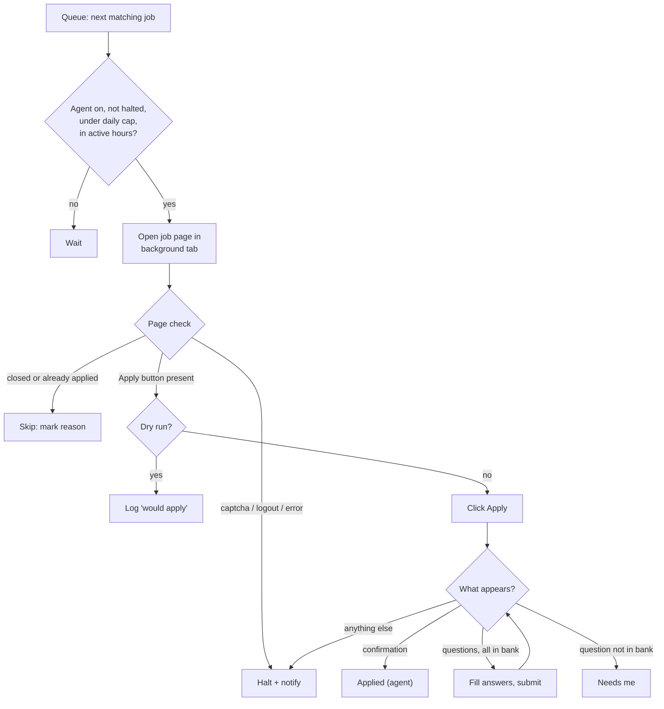
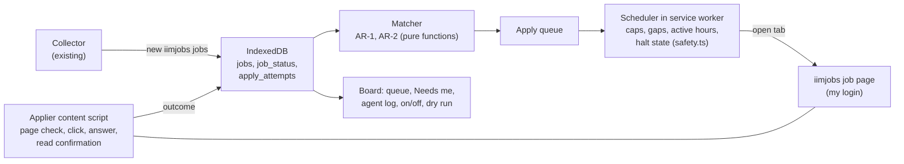

# PRD: iimjobs Auto-Apply Agent

| | |
| --- | --- |
| **Owner** | Me (sole user, PM and developer) |
| **Status** | v2: M0 discovery done (read-only), v0.1 built: dry run tested, live applying not yet tried on a real job |
| **Last updated** | 2026-10-27 |
| **Build plan** | [PLAN-auto-apply.md](PLAN-auto-apply.md) |
| **Builds on** | [PRD.md](PRD.md) (Naukri Fast-Apply Board, v0.1) |
| **Platform in scope** | [iimjobs](https://www.iimjobs.com) only (logged in) |

## 1. Summary

I will add an auto-apply agent to the job board extension. It picks iimjobs openings the board has already
collected, decides which ones match my criteria, and applies to them on iimjobs by itself, with no click from me.
It runs in my own Chrome, with my own iimjobs login, inside strict daily caps. Every apply is logged with the reason
it was chosen, so I can audit what it did. Success means every fresh, matching iimjobs job gets my application
within a few hours of posting, with no wrong applications and no risk to my iimjobs account.

v1 covers iimjobs only, and only jobs that apply on iimjobs itself (Easy Apply). Jobs that send me to a company site
(Lever, Turbohire, ...) stay manual.

## 2. Problem

- **Applying is still manual.** The board finds and sorts iimjobs jobs, but each apply is still open page, check
  fit, press Apply, answer questions. At 20 to 50 new iimjobs PM jobs a day, that is the slowest step left.
- **Speed decides visibility.** Recruiters on iimjobs read applications newest first and stop early. A job I reach
  a day late is often already shortlisted.
- **Most of my decisions are rule-based.** I apply when the title, experience range and location fit and the
  company is not on my blocklist. A machine can apply those rules the same way every time.

## 3. Goals and non-goals

**Goals**

| # | Goal |
| --- | --- |
| G1 | Apply to every matching iimjobs Easy Apply job without human action |
| G2 | Apply within 4 hours of the board first seeing the job (during active hours) |
| G3 | Never apply to a job that breaks my rules (wrong role, experience, location, blocked company, already applied) |
| G4 | Full audit trail: what was applied, when, and why it matched |
| G5 | Zero impact on my iimjobs account standing (same guardrail as the board's G5) |

**Non-goals (v1), with the reason for each**

| Non-goal | Why |
| --- | --- |
| Other sites (Naukri, Indeed, LinkedIn, ...) | Prove the agent on one site first. Each site's apply flow is different. LinkedIn stays capture-only for good |
| Company Site jobs (off-site `applyUrl`) | Every career site has its own form; too costly and error-prone |
| Free-text answers written by an LLM | Wrong or invented answers would hurt me with recruiters. v1 answers only from my own answer bank (see Q-2) |
| Tailoring the resume or a cover letter per job | Adds a document pipeline. v1 uses the resume already on my iimjobs profile |
| Messaging recruiters, follow-ups | Separate feature |
| Calling iimjobs APIs directly | Account risk. The agent clicks in real pages the same way I would |

**Change to the board PRD:** [PRD.md](PRD.md) lists "auto-apply" as a non-goal and the README says "It never
applies for you". This PRD makes one exception: iimjobs Easy Apply jobs, when I turn the agent on. Both documents
are updated when M2 ships.

## 4. Success metrics

**Baseline first:** for 7 days before launch, from the board's Stats panel: iimjobs jobs applied per day, and the
median hours from first seen to applied.

| Metric | Baseline | Target (after 2 weeks on) | How it's measured |
| --- | --- | --- | --- |
| Coverage: matching iimjobs Easy Apply jobs applied to | from baseline | 90% or more | Applied / eligible, from the agent log |
| Median first-seen-to-applied time | from baseline | under 4 hours (active hours) | `applied_at - first_seen_at` for agent applies |
| Apply success rate | n/a | 95% or more | Attempts that end with iimjobs' applied confirmation |
| Wrong-apply rate | n/a | 0 in a weekly review of 20 random agent applies | I check each against my rules and my own judgement |
| **Guardrail:** captchas, warnings, forced logouts, "too many applications" messages | 0 | 0 | Agent log + my observation. Any occurrence halts the agent until I press Resume |

## 5. Users and user stories

The only user is me: a product manager looking for a role, with the board extension installed in Chrome and
logged in to iimjobs.

| # | Story |
| --- | --- |
| US-1 | When a matching iimjobs job appears, it is applied to without me doing anything |
| US-2 | I set the rules once (titles, experience, locations, blocklist, daily cap) and change them any time |
| US-3 | I see each morning what the agent applied to yesterday, and why |
| US-4 | Before trusting it, I run it in dry-run mode and see what it *would* apply to |
| US-5 | When iimjobs asks a question the agent cannot answer, the job waits for me instead of getting a guess |
| US-6 | One switch stops the agent at once |

## 6. Functional requirements

P0 = v1 launch, P1 = within 2 weeks of launch, P2 = later.

| ID | Requirement | Pri | Story |
| --- | --- | --- | --- |
| AR-1 | **Eligibility.** A job is a candidate only if: site is iimjobs, apply type is Easy Apply, status is New or Seen (never Applied or Dismissed), not marked applied by iimjobs, no "Applied before" repost tag, and posted within the last 7 days | P0 | US-1 |
| AR-2 | **Match rules.** A candidate is applied to only if it passes every rule: title contains one of my include phrases and none of my exclude words; its experience range overlaps my years; location is one of mine or remote; company is not on my blocklist; salary, when shown, is at or above my floor. Rules reuse the board's filter and title-hide settings where they exist | P0 | US-2 |
| AR-3 | **Queue.** Matching jobs enter an apply queue, newest posted first. The queue is visible on the board with each job's match reasons | P0 | US-3 |
| AR-4 | **Apply run.** For the next queued job, the agent opens its iimjobs job page in a background tab, waits for it to load, checks the page still offers Apply (not closed, not already applied), clicks Apply, and completes the flow (section 7) | P0 | US-1 |
| AR-5 | **Success check.** A job becomes Applied (status `applied`, `applied_by: agent`) only when the page shows iimjobs' applied confirmation, or the job page reloads showing Applied. Otherwise the attempt is marked failed with the reason | P0 | US-1 |
| AR-6 | **Screening questions.** If the flow shows questions, the agent answers from my answer bank (section 7). If any required question has no stored answer, it closes the dialog without submitting and moves the job to **Needs me** with the question text | P0 | US-5 |
| AR-7 | **Caps and pacing.** At most 20 applies a day (setting, max 30); a random 3 to 8 minute gap between applies; only between 9:00 and 22:00; at most 1 job page open by the agent at a time | P0 | — |
| AR-8 | **Halt.** A captcha, a logout, an error page, an unexpected dialog, or any iimjobs message about application limits stops the agent, closes its tab and sends a desktop notification. It restarts only when I press Resume (shared with the board's halt) | P0 | US-6 |
| AR-9 | **Kill switch.** An Auto-apply on/off toggle in the board header. Off by default. Turning it off stops before the next click, even mid-run | P0 | US-6 |
| AR-10 | **Dry run.** A mode that runs AR-1 to AR-4 up to the page check, then logs "would apply" without clicking. On by default the first time the agent is enabled | P0 | US-4 |
| AR-11 | **Audit log.** Each attempt records job, time, rules matched, answers given, outcome and failure reason. Kept for 180 days; exportable as CSV | P0 | US-3 |
| AR-12 | **Daily summary.** The board shows "Agent: 14 applied, 2 need you, 1 failed since yesterday" with links; optional desktop notification at 21:00 | P1 | US-3 |
| AR-13 | **Needs me tab.** Jobs waiting on an answer. When I add the answer, it is saved to the bank and the job goes back in the queue | P1 | US-5 |
| AR-14 | **Retry.** A failed attempt is retried once, at least 1 hour later. A second failure leaves it in Failed with an "Open on iimjobs" link | P1 | — |
| AR-15 | **Trigger after capture.** When an iimjobs refresh adds new jobs, matching ones are queued at once, so G2 holds without a separate schedule | P1 | US-1 |
| AR-16 | **Per-company cap.** At most 2 applies to the same company in 7 days, so I don't spam one recruiter | P2 | — |
| AR-17 | **Match score.** Rank queued jobs by skill overlap with my profile keywords; apply to the top N when the queue is longer than the daily cap | P2 | US-1 |

### Acceptance criteria (P0)

- **AR-1/AR-2:** Given 10 captured iimjobs jobs where 4 match every rule, 2 are Company Site, 2 have a blocked
  company and 2 are already applied, then exactly the 4 matching jobs are queued.
- **AR-4/AR-5:** Given a queued job with a plain one-click Apply, when the agent runs, then within 2 minutes the job
  is Applied on the board, the iimjobs job page shows Applied, and the log shows the matched rules.
- **AR-6:** Given a job whose apply dialog asks a required question that is not in the answer bank, then nothing is
  submitted and the job is in Needs me with the question text.
- **AR-7:** Given 40 matching jobs, then no more than 20 are applied to that day, no two applies are less than 3
  minutes apart, and none happen outside 9:00 to 22:00.
- **AR-8:** Given iimjobs shows a captcha mid-run, then the agent's tab closes, no further click happens, a
  notification appears, and the agent stays halted after a browser restart until I press Resume.
- **AR-9:** Given the agent is off, then no iimjobs page is opened or clicked by the agent, whatever is in the queue.
- **AR-10:** Given dry-run is on, then the log shows "would apply" entries and no job's status changes.

## 7. Apply flow, data model and rules

### Apply flow (to be confirmed in M0)

**M0 findings, 2026-10-27** (read-only on the live site; no Apply was pressed):

- **Confirmed.** Job pages are `/j/<slug>-<id>` (Next.js). The apply control is `button[data-track="apply-job"]`,
  shown twice (header and floating). It reads "Apply" when open and "Applied" (disabled) after applying, which is
  the success signal the agent uses.
- **Confirmed.** `__NEXT_DATA__` → `initialState.botDetection.captchaShown` flags a captcha and
  `initialState.app.redirectedFromExpiredJD` a closed job.
- **Terms.** iimjobs' terms (`/terms`) do not mention automated applying. They forbid getting around its measures
  against robots and scraping, so the agent never solves or avoids a captcha: it halts.
- **Confirmed by the first live apply (2026-10-27).** After a one-click Apply, iimjobs leaves the job page for
  `/job/applied?ref=jd&jobId=<id>` ("Your application has been submitted successfully!"). The agent watches its tab
  for that page; anything unclear after a click is checked by reloading the job page and looking for "Applied".

**Original M0 checklist:**

- The job page URL and how the Apply button is found (selector, text "Apply"), and how it looks when already
  applied or closed.
- Whether Apply is one click or opens a dialog (resume choice, screening questions, notice period, current CTC).
- The confirmation signal after a successful apply (on-page text, a network response the content script can see,
  or the `applied` flag on the next `gladiator.iimjobs.com/job/search` capture, which the parser already reads).
- Whether iimjobs limits applications per day or shows warnings, and at what volume.
- iimjobs' terms of use on automated applications. If they forbid it, the project stops at M0 (see section 12).

### Answer bank

A local list of question patterns and my answers, edited in Settings. Matching is by normalised question text
(lower case, punctuation removed) and, for choice questions, the option text.

| Example question pattern | Answer |
| --- | --- |
| total experience / years of experience | 8 |
| current ctc | (my value) |
| expected ctc | (my value) |
| notice period | (my value) |
| willing to relocate to <city> | Yes for my locations, otherwise the job is not a match |

A question that matches no pattern, or a choice question where none of the options matches my answer, sends the job
to Needs me (AR-6). The agent never guesses.

### Data model additions

New `apply_attempts` table; `job_status` gains one field. Refreshes never touch either.

| Field | Type | Notes |
| --- | --- | --- |
| attempt_id | auto key | |
| job_id | text | iimjobs job ID (`iimjobs-<id>`) |
| started_at, finished_at | timestamp | |
| mode | enum | `live`, `dry_run` |
| matched_rules | text list | e.g. "title: product manager", "exp 7-10 overlaps 8" |
| answers | list of {question, answer} | What was submitted |
| outcome | enum | `applied`, `would_apply`, `skipped`, `needs_me`, `failed`, `halted` |
| reason | text | For anything but `applied` |
| `job_status.applied_by` | enum | `me`, `agent`. Lets Stats compare the two |

Settings gain: `autoApply` (bool, default off), `dryRun` (bool, default on), `dailyApplyCap` (default 20),
`applyRules` (includes, excludes, my years, locations, salary floor, blocklist), `answerBank`.

### Edge cases

| Case | Behaviour |
| --- | --- |
| Job closed between capture and apply | Skipped with reason "closed"; status unchanged |
| iimjobs already shows Applied (I applied myself) | Job set to Applied (`applied_by: me`), no click |
| Same role reposted with a new ID | Skipped if title + company match an Applied job (board's "Applied before" rule) |
| I dismiss a queued job | Removed from the queue at once |
| Logged out | Halt with "Log in to iimjobs, then Resume" |
| Browser closed mid-flow | On restart, an attempt with no `finished_at` is checked on its job page: Applied if the page shows it, otherwise failed and retried per AR-14 |
| Page layout changed (Apply button not found) | Attempt failed with "Apply button not found"; three in a row halt the agent with "Agent needs update" |

## 8. Solution approach

The agent lives inside the existing extension (board PRD option A). No server, no second browser.

| Part | Where | Job |
| --- | --- | --- |
| Matcher | `src/shared/auto-apply/match.ts` | Pure eligibility and rule checks, unit-tested against fixtures |
| Answer bank | `src/shared/auto-apply/answers.ts` | Question normalising and lookup |
| Scheduler | `src/background/` (alongside refresh) | Picks the next job, enforces AR-7 and AR-8 using the same `safety.ts` halt state as refreshes, so a captcha anywhere stops both |
| Applier | `src/content/applier-iimjobs.ts` | Runs only in tabs the agent opened; reads the page, clicks, fills answers, reports outcome. All iimjobs selectors in this one file |
| Board UI | `src/board/` | Auto-apply toggle, dry-run toggle, Queue / Needs me / Agent log views, rules and answer bank in Settings |

**Why DOM clicks and not API calls:** the board's rule is "only normal page loads in my own browser". Clicking the
real button sends exactly what a manual apply sends, with iimjobs' own tokens and checks. The cost is fragility when
the page changes, handled by AR-8, the "Agent needs update" halt and fixture tests of saved page HTML.

**Agent refresh and apply share one budget:** an iimjobs page opened by the agent counts toward the iimjobs safety
limits, and the agent never runs while an iimjobs refresh tab is open.

## 9. UX

- **Header:** "Auto-apply: On · 6/20 today · next in 4 min" or "Off" or "Halted: captcha. Resume". One click toggles.
  Dry run shows a "Dry run" badge.
- **Agent tab** on the board with three lists: **Queue** (match reasons per job, Remove), **Needs me** (question
  text, Answer, Open on iimjobs), **Log** (outcome, time, reasons; CSV export).
- **Settings → Auto-apply:** rules, daily cap, answer bank, dry-run toggle, summary notification toggle.
- **First enable:** a short screen: what the agent will do, the caps, that dry run is on, and "Turn on live
  applying" only after at least one dry-run day.
- Rows on the existing iimjobs tab show an "Agent applied" tag.

## 10. Non-functional requirements

| Area | Requirement |
| --- | --- |
| Account safety | Only pages in my own Chrome; no direct API calls; AR-7 caps; halt on any anomaly. Defaults sit below what M0 finds as a normal daily volume |
| Correctness | No submit without every required field answered from my bank. A wrong apply is worse than a missed one |
| Terms of use | Personal use only. I read iimjobs' terms in M0 and stop if they prohibit automated applying |
| Privacy | Answer bank, rules and logs stay in local IndexedDB. Nothing leaves the machine |
| Resilience | Selector or flow changes fail closed (no click) and surface "Agent needs update" |
| Testability | Matcher and answer bank are pure and unit-tested; the applier is tested against saved iimjobs page HTML in `tests/fixtures/` |

## 11. Plan

Estimates assume one developer working with Claude Code.

| Milestone | Scope | Exit gate | Estimate |
| --- | --- | --- | --- |
| M0 Discovery | Apply manually to 3 to 5 iimjobs jobs with DevTools open: record the button, dialogs, questions, confirmation signal; save page fixtures; read the terms | Flow and signals confirmed; go / no-go on terms | 1 day |
| M1 Matcher + dry run | AR-1 to AR-3, AR-10, AR-11, Agent tab (Queue, Log) | 3 dry-run days where every "would apply" is one I agree with | 2 days |
| M2 Live apply | AR-4 to AR-9 | 20 live applies, all confirmed, 0 wrong, 0 guardrail events | 3 days |
| M3 Hands-off | AR-12 to AR-15 | Section 4 targets met after 2 weeks | 2 days |
| M4 Extras | AR-16, AR-17 | — | 2 days |
| Later | Second site (likely Naukri Easy Apply) | Separate PRD section after iimjobs proves out | TBD |

## 12. Risks

| Risk | Likelihood | Impact | Mitigation |
| --- | --- | --- | --- |
| iimjobs terms forbid automated applying | Medium | Project stops | Checked in M0 before any code |
| Account flagged or limited for volume | Medium | Loss of access, the worst outcome | Low caps, random gaps, active hours, halt on any warning, guardrail metric |
| Wrong applications (bad fit) | Medium | Wasted recruiter goodwill | Strict all-rules match, dry run first, weekly audit of 20 applies |
| Screening questions vary a lot | High | Many jobs land in Needs me | Answer bank grows from Needs me answers (AR-13); metric shows the share |
| Page layout changes | High | Agent stops working | One selector file, fail-closed, "Agent needs update" halt, fixture tests |
| Confirmation not detectable | Low | Can't mark Applied | Fall back to the `applied` flag on the next search capture |

## 13. Open questions and decisions

| ID | Question | Owner | Due |
| --- | --- | --- | --- |
| Q-1 | Does iimjobs' Easy Apply ever require a cover note or file upload? If so, v1 sends those jobs to Needs me | Me (M0) | End of M0 |
| Q-2 | Allow an LLM (Claude) to draft answers to unknown questions, shown to me for approval before submit? It breaks "no human intervention" for those jobs and sends job text off the machine. Proposed: no in v1, revisit after M3 | Me | After M3 |
| Q-3 | Default daily cap: 20 assumed. Set from M0's finding of a normal volume | Me (M0) | End of M0 |
| Q-4 | Should jobs captured with an experience range (currently ignored by the parser) be used for matching? | Me | M1 |

## 14. Change log

| Version | Date | Change |
| --- | --- | --- |
| v1 | 2026-10-27 | First draft |
| v2 | 2026-10-27 | M0 findings; v0.1 built per PLAN-auto-apply.md. Daily cap counts pages opened, dry run included. Logout and "page changed" stop only the agent; a captcha stops everything |
| v3 | 2026-10-27 | By the user's choice, one-click applies only by default: a form asking for details is closed unsubmitted and the job left for the user (AR-6 form filling becomes an opt-in setting) |
| v4 | 2026-10-27 | Instahyre added as a second site (job page `/job-<id>-<slug>/`, "Apply now" → "Application sent!", confirmed read-only); sites ticked per user; agent working hours set by the user (default 9:00 to 22:00) |
| v5 | 2026-10-27 | Naukri added (`#apply-button` → `#already-applied`, confirmed read-only; company-site jobs and chatbot questions are never handled); "All platforms" checkbox |
| v6 | 2026-10-27 | Wellfound added (`button[class*="applyButton"]`, confirmed read-only; applied state unseen); per-platform gap in seconds with round-robin queue; a click without a confirmed result is never repeated on any site |
