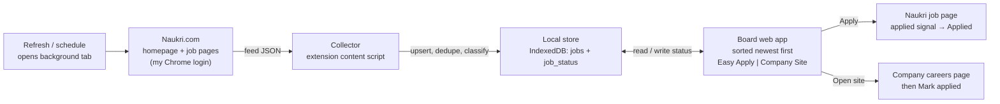

# PRD: Naukri Fast-Apply Job Board

| | |
| --- | --- |
| **Owner** | Me (sole user, PM and developer) |
| **Status** | v3: M0 discovery done, D-1 decided (option A), v0.1 built |
| **Last updated** | 2026-10-21 |
| **Source page** | [Naukri homepage](https://www.naukri.com/mnjuser/homepage) (logged in) |

## 1. Summary

I will build a personal job board web app that collects every opening on my logged-in Naukri homepage, sorts them by posting date (newest first), and splits them into two tabs: **Easy Apply** (apply inside Naukri) and **Company Site** (apply on an external careers page). Success means applying to fresh, relevant jobs within hours of posting, at twice my current weekly volume, with no risk to my Naukri account.

## 2. Problem

- **Buried freshness.** The homepage spreads jobs across several widgets (recommended, profile match, "you may like") and does not sort them strictly by posting date. New jobs sit next to month-old ones.
- **Hidden apply type.** I can't tell whether a job is a one-click Naukri apply or a redirect to a company site until I open it. That costs a click and a page load per job.
- **No memory.** Naukri keeps showing jobs I already applied to or rejected, so I re-scan the same listings every visit.

Why it matters: early applicants get seen first on Naukri, so hours of delay reduce my response rate.

## 3. Goals and non-goals

**Goals**

| # | Goal |
| --- | --- |
| G1 | One list of all homepage openings, sorted newest posting first |
| G2 | Two tabs by apply type: Easy Apply and Company Site |
| G3 | Act on any job (apply, open site, dismiss) in one click or one keystroke |
| G4 | Never re-show a job I applied to or dismissed |
| G5 | Zero impact on my Naukri account standing |

**Non-goals (v1), with the reason for each**

| Non-goal | Why |
| --- | --- |
| Auto-apply or bulk apply | Account risk, and a bad fit ruins applications. Every apply stays a human click |
| Filling external company forms | Every career site is different. Too costly for the payoff |
| Sources beyond homepage feeds and the one saved search (other searches, alerts) | Keeps v1 small. Planned for v2 (milestone M5) |
| Multi-user, hosted or mobile app | Personal tool. Hosting would mean storing my Naukri session on a server |

## 4. Success metrics

**Baseline first:** for 7 days before launch, I log my applications in a spreadsheet: count per day, and for 10 of them the hours between posting and my apply.

| Metric | Baseline | Target (after 2 weeks of use) | How it's measured |
| --- | --- | --- | --- |
| Applications per week | from baseline log | 2x baseline | Count of jobs with status Applied in the app's Stats panel |
| Median posting-to-apply time | from baseline log | under 24 hours | `applied_at - posted_at` across applied jobs (Stats panel) |
| Capture coverage | n/a | 95% or more | On 3 separate days, count homepage jobs by hand vs. jobs captured in that refresh |
| Apply-type accuracy | n/a | 98% or more | Spot-check 50 jobs by opening each one on Naukri |
| **Guardrail:** account warnings, captchas, forced logouts caused by the app | 0 | 0 | Error log + my observation. Any occurrence pauses automated refresh |

## 5. Users and user stories

The only user is me: an active job seeker on Chrome on a laptop, logged in to Naukri, screening dozens of jobs a day.

| # | Story |
| --- | --- |
| US-1 | When I open the board, I see the newest openings first, so I apply before the applicant pile grows |
| US-2 | On Easy Apply, I press Apply and finish on Naukri; the job then moves to Applied without retyping anything |
| US-3 | On Company Site, I press Open site, the careers page opens in a new tab, and I mark it Applied when done |
| US-4 | I dismiss a job and never see it again |
| US-5 | I see what is new since my last visit |
| US-6 | I narrow the list by posted-within, experience, location, salary floor and keywords |
| US-7 | The list stays fresh without me visiting Naukri myself |

## 6. Functional requirements

P0 = v1 launch, P1 = within 2 weeks of launch, P2 = later.

| ID | Requirement | Pri | Story |
| --- | --- | --- | --- |
| FR-1 | **Capture.** Read job data from every homepage feed while the Naukri homepage loads in my browser (my session, my page loads) | P0 | US-1 |
| FR-2 | **Refresh.** A Refresh button opens Naukri's recommended-jobs page (all homepage feeds in full) in a background tab, captures its feeds, then closes the tab | P0 | US-7 |
| FR-3 | **Dedupe.** One record per Naukri job ID. Track which feeds showed it | P0 | US-1 |
| FR-4 | **Date sort.** Convert relative labels to an absolute `posted_at` and sort newest first; ties go to the most recently first seen | P0 | US-1 |
| FR-5 | **Classify** each job as Easy Apply, Company Site or Unknown (rules in section 7) | P0 | US-2, US-3 |
| FR-6 | **Tabs:** Easy Apply and Company Site, each with a count. An Unknown tab appears only when it has jobs | P0 | US-2, US-3 |
| FR-7 | **Easy Apply action:** Apply opens the Naukri job page in a new tab. If the page shows Naukri's applied confirmation, the job becomes Applied automatically; otherwise, when I return, the board asks "Applied to <title>? Yes / No" | P0 | US-2 |
| FR-8 | **Company Site action:** Open site opens `external_url` in a new tab. Mark applied sets status Applied | P0 | US-3 |
| FR-9 | **Status:** New, Seen, Applied, Dismissed, kept across refreshes. Applied and Dismissed hidden by default, with Undo for 5 seconds | P0 | US-4 |
| FR-10 | **Scheduled refresh** using the FR-2 mechanism, every 30 minutes by default (minimum 15), only while Chrome is running | P1 | US-7 |
| FR-11 | **Unknown resolution:** open the job page in a background tab to read its apply button, at most 1 every 5 seconds and 50 a day | P1 | US-2, US-3 |
| FR-12 | **Filters:** posted within (24h, 3d, 7d, all), experience, location, salary floor, keyword include and exclude, company blocklist; remembered between sessions. Default posted-within: 7d. Until FR-12 ships, the board shows all jobs | P1 | US-6 |
| FR-13 | **New badge** per tab: jobs first seen since my last board visit | P1 | US-5 |
| FR-14 | **Keyboard:** j/k move, Enter apply or open, d dismiss, m mark applied, u undo | P1 | US-1 |
| FR-15 | **Stats panel:** the section 4 metrics, computed from local data | P1 | — |
| FR-16 | Desktop notification for new jobs that match my filters | P2 | US-5 |
| FR-17 | CSV export of applied jobs (title, company, applied date, link) | P2 | — |

### Acceptance criteria (P0)

- **FR-1/FR-3:** Given the homepage shows 40 unique jobs across feeds, when it loads, then 38 or more appear on the board with no duplicate job IDs.
- **FR-4:** Given jobs labelled "Just now", "2 days ago" and "30+ days ago", then they appear in that order, and the "30+ days" job shows "30+ days (approx.)".
- **FR-5/FR-6:** Given a job whose Naukri page shows "Apply on company site", then it appears only in Company Site, and its Open site link goes to the company URL.
- **FR-7:** Given I press Apply and complete the apply on Naukri, then within 5 seconds of returning to the board the job is Applied (automatically or after one "Yes" click).
- **FR-9:** Given I dismiss a job and refresh, then it does not reappear; given I press Undo within 5 seconds, then it returns to its place.
- **FR-2:** Given my Naukri session has expired, when I refresh, then the board shows "Logged out of Naukri. Log in, then Refresh" with a login link, and no jobs are removed.

## 7. Data model and rules

The `jobs` table holds what Naukri shows; the `job_status` table holds what I did. A refresh updates `jobs` and never touches `job_status`.

| Field | Type | Notes |
| --- | --- | --- |
| job_id | text, key | Naukri job ID |
| title, company, location | text | As shown |
| experience, salary | text + parsed min/max | Salary often "Not disclosed": parsed as null, and passes salary filters only if "include undisclosed" is on (default on) |
| skills | text list | Key skill tags |
| posted_at | timestamp | Derived from the label (rules below) |
| posted_label, posted_approx | text, bool | Raw label; true for "30+ days" |
| first_seen_at, last_seen_at | timestamp | Set by the app |
| source_feeds | text list | Homepage widgets that showed it |
| apply_type | enum | easy_apply, company_site, unknown |
| naukri_url, external_url | text | external_url null unless company_site |
| status, status_at | enum, timestamp | in `job_status`: new, seen, applied, dismissed |

**Apply-type rules** (the first match wins):

1. The job data includes an external apply or redirect URL → Company Site.
2. The job page shows "Apply on company site" → Company Site.
3. The job page shows Naukri's in-site Apply → Easy Apply.
4. Otherwise → Unknown, handled by FR-11.

Naukri does not document these fields. Milestone M0 confirms the real field names and the applied-confirmation signal (FR-7) before any rule is coded.

**Date rules:** "Just now", "Few hours ago" or "Today" → fetch time; "N days ago" → fetch time minus N days; "30+ days ago" → fetch time minus 30 days, approx = true. A job keeps the earliest `posted_at` it was ever given, so its place in the sort never jumps.

**Edge cases**

| Case | Behaviour |
| --- | --- |
| Job removed from Naukri or closed | Stays on the board until `last_seen_at` is 7 days old, then is greyed out with "May be closed" |
| Same role reposted with a new job ID | Treated as a new job. If title + company match an Applied job, it shows an "Applied before" tag |
| Unknown jobs left after the FR-11 daily cap | Stay in Unknown with an "Open on Naukri" link |
| Captcha or error during refresh | Stop, keep existing data, pause scheduled refresh for 1 hour, show a banner |
| Data retention | Jobs older than 60 days that I never applied to are purged; Applied records are kept |

## 8. Solution approach

### Decision D-1 (open): how the app gets data

| Option | How | Pros | Cons |
| --- | --- | --- | --- |
| **A. Chrome extension + board web app (recommended)** | The board is a React web app served from the extension (a full browser tab you can bookmark). A content script reads the feeds as the homepage loads in my own Chrome | Uses my real login; no server; Naukri sees only normal page loads | Refreshes only while Chrome is open; laptop only |
| B. Local scraper + localhost web app | Playwright runs a logged-in browser on a schedule; Node + SQLite; React board at `localhost` | Refreshes even when I'm not using Chrome | Separate login to keep alive; more bot-like traffic; more to build |
| C. Bookmarklet | I click it on the homepage; it copies jobs to the board | Simplest | Manual every time; no FR-10 |

**Why A:** it meets every P0 with the lowest account risk (G5) and no infrastructure. The board is still a web app; only its hosting differs. If FR-10's "only while Chrome is open" proves too limiting after 2 weeks, B reuses the same board UI and parser.

### Architecture (option A)

**Assumptions, checked in M0 on 2026-10-21 against the live page:**

- A-1 **Confirmed.** Feeds come from `POST /jobapi/v2/search/recom-jobs`. Naukri also caches three of them (profile, apply, preference) in `localStorage` under `srp_simjobs_reco_wdgt_<feed>_<hash>`. The full feed list lives at `/mnjuser/recommendedjobs` (tabs: Profile, Applies, Preferences, You might like), so refresh loads that page rather than the homepage.
- A-1b **Confirmed 2026-10-23.** Search pages call `GET /jobapi/v3/search?...&pageNo=N` and return `jobDetails` with the same job fields as recom-jobs. `sort=f` in the page URL sorts by date; page N lives at `/product-manager-jobs-N?...`. Refresh now also loads the saved product manager search (feed `search`).
- A-2 **Confirmed, better than expected.** `jobId` is stable and `createdDate` is an absolute epoch-ms timestamp. Relative labels (`footerPlaceholderLabel`) are only a fallback.
- A-3 **Confirmed in feed data.** `companyApplyJob` (boolean) gives the apply type; `applyRedirectUrl` / `companyApplyUrl` give the external link. All 79 cached live jobs validated, all were classified, and every company-site job had an https link. FR-11's job-page lookups are therefore not needed in v1.
- Still to verify with the installed extension: the "You might like" feed (54 jobs) is not cached, so it must come through the network hook. Check that the board's count matches Naukri's tab totals.
- The Easy Apply "Applied" signal (FR-7) is detected heuristically and has not been tested against a real apply; the "Applied? Yes / No" prompt covers it.

**Stack:** TypeScript, React + Vite (board), Dexie over IndexedDB, Chrome Manifest V3 with `chrome.tabs` and `chrome.alarms`, Vitest with saved feed responses as fixtures. All parsing lives in one module, so Naukri changes touch one file.

## 9. UX

One screen made for fast scanning:

- **Header:** last refreshed time, Refresh, status (OK, refreshing, logged out, error), filter bar.
- **Tabs:** "Easy Apply (42) · 12 new" and "Company Site (17) · 3 new".
- **Row:** title + company; location, experience, salary, posted time ("2h ago", exact time on hover); skill chips; actions on the right. Rows posted in the last 24 hours are highlighted.
- **Actions:** Easy Apply → Apply, Dismiss. Company Site → Open site, Mark applied, Dismiss. The title opens the Naukri page.
- **Applied view:** a toggle lists applied jobs with dates, for follow-up.
- **First run:** "Open your Naukri homepage once while logged in, or press Refresh" with a button.
- **Accessibility:** every action works by keyboard, there is visible focus, and contrast meets WCAG AA. Status is shown in text, not only colour.

## 10. Non-functional requirements

| Area | Requirement |
| --- | --- |
| Account safety | Only normal page loads in my own browser: at most 1 homepage load per 15 minutes and 50 job-page loads a day. No direct calls to Naukri's APIs. No auto-apply |
| Terms of use | Personal use only; no sharing or resale of data. I review Naukri's terms before M1 and stop if they prohibit this use |
| Privacy | No password stored; uses the existing Chrome session. All data stays in local IndexedDB. No analytics leave the machine |
| Performance | Board renders 500 jobs in under 1 second; a refresh finishes in under 30 seconds |
| Resilience | A parse failure shows "Parser needs update" and keeps the last good data; fixture tests run before every change |

## 11. Plan

Estimates assume one developer working with Claude Code.

| Milestone | Scope | Exit gate | Estimate |
| --- | --- | --- | --- |
| M0 Discovery | Record homepage network calls in DevTools; save fixtures; find the apply-type fields and the applied-confirmation signal; review Naukri's terms | Fields confirmed; D-1 decided | 1 day |
| M1 Collector | FR-1 to FR-5 | Coverage 95% or more on 3 days | 3 days |
| M2 MVP board | FR-6 to FR-9 | Used for all my real applications for 1 week | 4 days |
| M3 Speed | FR-10 to FR-15 | Section 4 targets met after 2 weeks | 3 days |
| M4 Extras | FR-16, FR-17 | — | 2 days |
| M5 v2 sources | Saved searches and job alerts | — | TBD |

## 12. Risks

| Risk | Likelihood | Impact | Mitigation |
| --- | --- | --- | --- |
| Naukri changes page or data shape | High | Collector breaks | One parser module, fixture tests, "Parser needs update" banner |
| Account flagged for automation | Low | Loss of access | Normal page loads only, strict caps, guardrail metric, auto-pause |
| Apply type not in feed data | Medium | Many Unknown jobs | FR-11 job-page check; M0 confirms early |
| Applied signal not detectable | Medium | Extra click per apply | FR-7 fallback: "Applied? Yes / No" prompt |
| Coarse dates ("30+ days") | High | Fuzzy order for old jobs | Approx flag; posted-within filter hides them by default |

## 13. Open questions and decisions

| ID | Question | Owner | Due |
| --- | --- | --- | --- |
| D-1 | **Decided 2026-10-21: option A (extension).** Discovery showed the data is readable from the page itself | Me | Done |
| Q-1 | Does Naukri's Easy Apply sometimes show a questionnaire, and does FR-7 detect success after it? | Me (M0) | End of M0 |
| Q-2 | Add saved searches as sources in v1? **Decided 2026-10-23:** one saved search (product manager, 30 days, 6 yrs) in v1; more in v2 | Me | Done |

## 14. Change log

| Version | Date | Change |
| --- | --- | --- |
| v1 | 2026-10-21 | First draft |
| v2 | 2026-10-21 | Product director review: baselines and guardrail metric, acceptance criteria, edge cases, refresh mechanism resolved, web app vs. extension reconciled, plan with estimates, decision log |
| v3 | 2026-10-21 | M0 discovery results, D-1 decided, refresh targets the recommended-jobs page, FR-11 deferred (not needed), v0.1 implemented |
